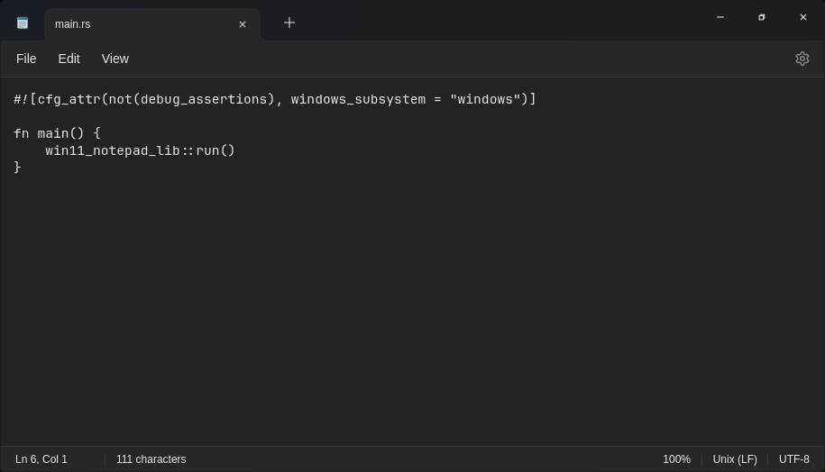
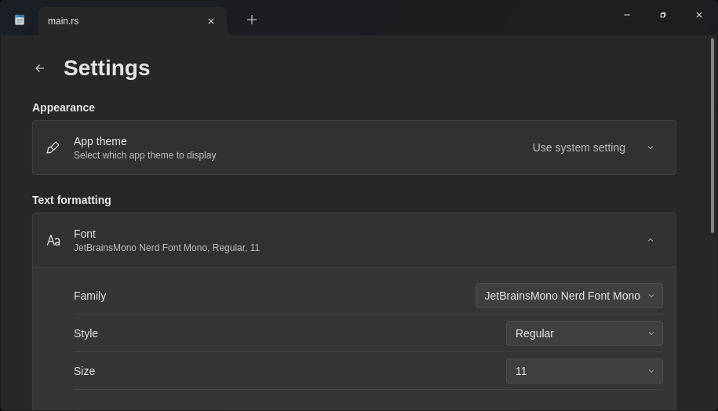
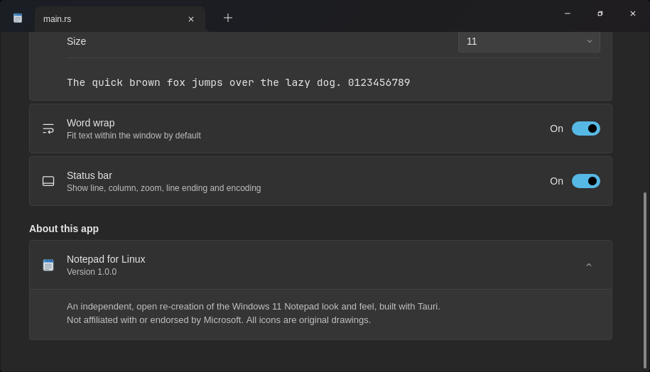

# Notepad for Linux

Windows 11 메모장 모양의 텍스트 편집기(Tauri v2)







## 기능

- 실행: `win11-notepad a.txt`
- 옵션: `--theme light|dark|system`, `--settings`

## 설치

```bash
sudo apt install ./win11-notepad_1.0.0_amd64.deb
```

```bash
chmod +x win11-notepad_1.0.0_amd64.AppImage
./win11-notepad_1.0.0_amd64.AppImage
```

## 빌드

Ubuntu 22.04+ / Debian 12+. Rust 1.77+, Node.js 18+.

```bash
sudo apt install -y libwebkit2gtk-4.1-dev build-essential curl wget file \
  libxdo-dev libssl-dev libayatana-appindicator3-dev librsvg2-dev patchelf
npm install
npm run tauri dev
npm run tauri build
```

- `src-tauri/target/release/bundle/deb/win11-notepad_1.0.0_amd64.deb`
- `src-tauri/target/release/bundle/appimage/win11-notepad_1.0.0_amd64.AppImage`

